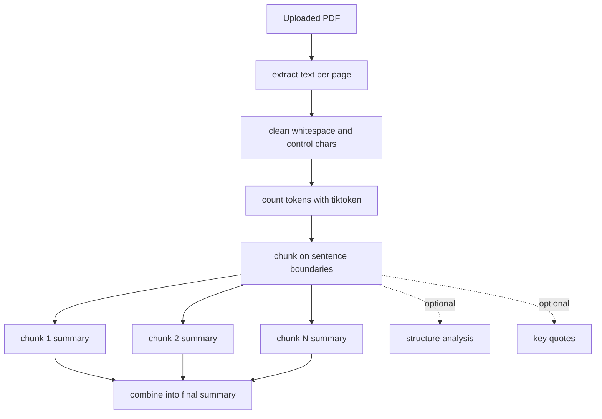

# 📄 PDF AI Summarizer

A Streamlit app that summarizes PDF documents with **Google Gemini** via **LangChain**. Upload a PDF, pick a summary style, and get a map-reduce summary, a structure analysis and optional key quotes — then export everything.

Built end to end across six phases: credential validation → PDF pipeline → LLM chains → UI → hardening → CI.

## Features

- **Real PDF pipeline** — extraction, control-character cleaning, whitespace normalisation, metadata and token counting
- **Token-aware chunking** — splits on sentence boundaries, hard-splits only oversized sentences, so no chunk ever exceeds the limit
- **Map-reduce summarization** — every chunk is summarized in parallel, then merged into one coherent result
- **Four styles** — `brief`, `detailed`, `bullet_points`, `executive`
- **Optional extras** — document structure analysis and up to 10 verbatim key quotes
- **Resilient** — retries only transient failures (429/quota/5xx/timeouts) with exponential backoff; a failing chunk never discards the whole document
- **Free reruns** — results are cached per file content and settings, so tweaking the UI never re-bills the API
- **Exports** — summary report as `.txt`, per-chunk statistics as `.csv`

## How it works



Three LangChain chains do the work: `CHUNK_SUMMARY` (map), `COMBINE` (reduce), plus `ANALYSIS` and `QUOTES` on demand. All prompts are `ChatPromptTemplate`s in `prompts.py`.

## Requirements

- Python 3.11+ (verified on 3.14.7)
- A Google Gemini API key — free at [aistudio.google.com/apikey](https://aistudio.google.com/apikey)

## Setup

```bash
python -m venv .venv
.venv\Scripts\activate           # macOS/Linux: source .venv/bin/activate
pip install -r requirements.txt
copy .env.example .env           # cp on macOS/Linux
```

Add your key to `.env`:

```dotenv
GEMINI_API_KEY=your-key-here
GEMINI_MODEL=gemini-3.1-flash-lite
```

## Verify before you run

```bash
python scripts/check_env.py
```

Checks that `.env` loads, the API key is accepted, and the configured model really generates text — it also prints which models your key can reach if the configured one is unavailable. Exit code `0` means you are ready.

## Run

```bash
streamlit run app.py
```

Then upload a PDF in the sidebar-driven UI, choose a style and click **Summarize**.

## End-to-end check

```bash
python scripts/e2e_check.py --pages 12 --style brief
```

Builds a 12-page PDF, runs the exact app code path against the live API, and verifies chunking, map-reduce, analysis, quotes and two error states. Costs a handful of small requests.

## Configuration

| Variable | Default | Purpose |
|---|---|---|
| `GEMINI_API_KEY` | — | Required. Google Gemini API key. |
| `GEMINI_MODEL` | `gemini-3.1-flash-lite` | Default model; changeable in the sidebar. |

Chunk size is set in the sidebar (500–8000 tokens, default 4000). Larger chunks mean fewer calls; smaller chunks suit dense documents.

## Project layout

```
app.py                Streamlit UI: upload, settings, progress, tabs, downloads
pdf_processor.py      Extraction, cleaning, token counting, chunking, metadata
summarizer.py         Gemini chains, retries, map-reduce, analysis, quotes
prompts.py            All ChatPromptTemplates and summary styles
utils.py              Hashing, formatting, statistics and export builders
scripts/check_env.py  Credential and model validation
scripts/e2e_check.py  Live end-to-end gate
scripts/demo_summarize.py  Chain-by-chain proof of life
scripts/make_sample_pdf.py Generates a fixture PDF
tests/                84 tests, no API key required
```

## Testing

```bash
pip install -r requirements-dev.txt
pytest          # 84 tests, model mocked, no network
ruff check .    # lint
```

Tests cover cleaning, chunk boundaries, content preservation, corrupt/blank PDFs, message parsing, per-chunk failure isolation, retry behaviour, export formatting and a headless Streamlit smoke test.

## Troubleshooting

- **"No extractable text"** — the PDF is scanned images; run OCR first.
- **429 / quota errors** — transient failures retry automatically; if they persist, wait a minute or pick a lighter model.
- **Model not available / 404** — run `scripts/check_env.py`; it names a model your key can reach.
- **API key not found** — `.env` must sit next to `app.py`; restart Streamlit after editing it.
- **Slow first run** — the tiktoken vocabulary downloads once, then caches.

## Cost

Cost scales linearly with document length: one request per chunk, plus one for the combine step and one each for analysis and quotes. Results are cached per file, so exploring the UI is free after the first run.

## License

MIT — see [LICENSE](LICENSE).
